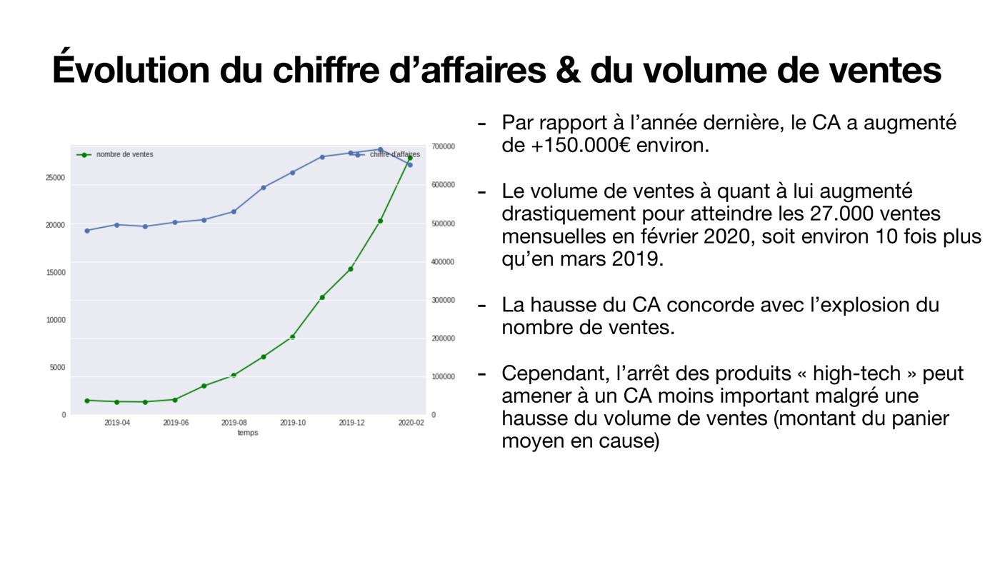

# Analyse des ventes d'un e-commerce — rapport marketing mensuel

> Le volume de ventes a été multiplié par 10 en un an, mais le taux de conversion est passé de 11 % à 5 %. Le rapport le montre et propose 3 axes d'action.



**Projet 2 · OpenClassrooms Data Analyst · octobre 2025** · Excel (tableaux croisés dynamiques, graphiques) · Storytelling

---

## Besoin métier
L'entreprise s'est recentrée sur la nourriture et les biens de consommation et a arrêté le high-tech. Le responsable marketing veut un **rapport mensuel** qui réponde à deux questions :
- quel a été l'effet de ce repositionnement sur le CA, les volumes, le panier et la conversion ?
- que pèsent les clients affiliés ?

## Données
- **Sources :** exports mensuels des ventes, des visites et du temps passé sur le site (mars 2019 → février 2020), plus le détail des achats des clients affiliés de février.
- **Qualité :** les données étaient propres, avec des contrôles de cohérence entre les onglets.
- **Limite :** l'historique ne couvre que 12 mois, ce qui empêche de mesurer une saisonnalité.

## Démarche
1. Consolider les données mensuelles et calculer les indicateurs : CA, nombre de ventes, panier moyen, taux de conversion.
2. Construire un **tableau de bord Excel**, puis un tableau croisé client × catégorie pour les affiliés.
3. Choisir 5 graphiques, chacun porteur d'un message, et les mettre en récit pour une présentation de 15 minutes.

## Résultats
| Constat | Chiffre |
|---|---|
| Volume de ventes | ×10 entre mars 2019 et février 2020 (≈ 27 000 ventes/mois) |
| CA | ≈ +150 k€ sur un an, freiné par la baisse du panier moyen après l'arrêt du high-tech |
| Poids de la nourriture | ≈ 3/4 du CA mensuel, 6 mois après son lancement |
| Panier | Entre 30 et 50 € pour la majorité des clients ; il augmente avec le temps passé sur le site |
| Taux de conversion | 11 % → 5 %, alors que les visites dépassent 500 000 |

## Recommandations
- **Conversion :** fluidifier le tunnel d'achat pour transformer l'afflux de nouveaux visiteurs.
- **Panier moyen :** élargir la gamme de biens de consommation pour compenser la sortie du high-tech.
- **Affiliés :** cibler les clients affiliés les plus rentables, identifiés dans le tableau client × catégorie.

## Limites et pistes
- Il s'agit d'une analyse descriptive, sans test statistique sur le lien entre temps passé et panier.
- La baisse de conversion est expliquée par une hypothèse (visiteurs en découverte) qui reste à vérifier, par exemple avec des données d'acquisition par canal.

## Compétences mobilisées
`Excel` · `Tableaux croisés dynamiques` · `Visualisation` · `Storytelling` · `Recommandations marketing`

## Contenu
```
livrables/
  Cabart_Leo_1_rapport_mensuel_102025.xlsx    # tableau de bord + tableau client × catégorie + données
  Cabart_Leo_2_rapport_marketing_102025.pdf   # rapport en 5 graphiques commentés
```

---
Leo Cabart · Data Analyst · [Portfolio](https://lcabart21.github.io) · [GitHub](https://github.com/lcabart21)
